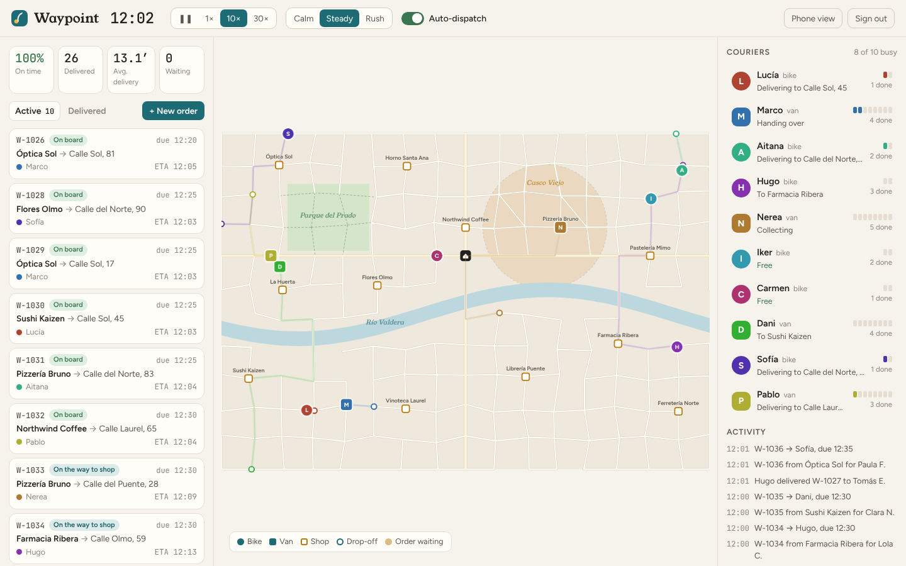
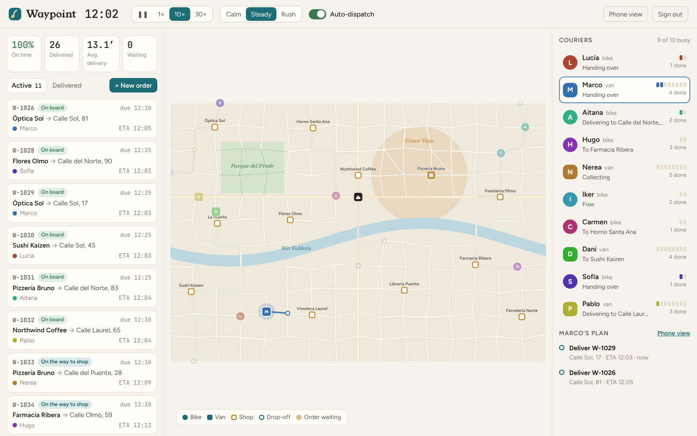
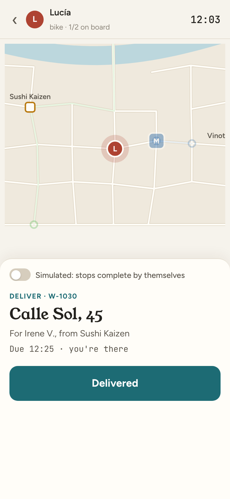

# Waypoint

A live dispatch board for same-day deliveries. Shops in the fictional city of Valdera send parcels; ten couriers on
bikes and vans pick them up and drop them off. Waypoint decides who takes each order the moment it arrives, keeps
re-planning as the afternoon unfolds, and shows all of it on a live map. A dispatcher can step in at any point, and a
courier can run their own stops from a phone.



| A courier's plan on the board | The courier's phone |
| --- | --- |
|  |  |

## What it does

- **Automatic dispatch.** Every new order is placed by *cheapest insertion*: the planner tries the pickup and the
  drop-off at every position in every courier's plan and keeps the placement that adds the least cost. Cost counts
  each customer's wait, minutes past the promised time (weighted 6×), and a little road time. Capacity is checked
  stop by stop, so a bike never carries more than it can. In a 3-hour test run, 99% of 124 orders arrive on time.
- **Re-planning.** Every simulated minute, orders not yet collected are moved to another courier if that saves at
  least two minutes. Orders a dispatcher assigned by hand are pinned and never moved automatically.
- **Real routing.** Valdera is generated from a seed: a street grid with a river crossed only at three bridges, an
  old town where vans crawl, a park only bikes can cut through, and two fast avenues. Fastest routes for bikes and
  vans are precomputed with Dijkstra over every pair of junctions, so the planner can ask "how long from A to B"
  thousands of times per tick.
- **Live everywhere.** The simulation pushes a full snapshot over a WebSocket twice a second. Couriers glide
  between updates, and ETAs, the on-time rate and the activity feed update as they happen.
- **Two roles.** Dispatchers control the clock, demand and auto-dispatch, create orders by clicking the map, and
  reassign orders. Couriers get a phone view: the next stop, their route, and a "Picked up" / "Delivered" button.
  Switch a courier to phone control and the simulation waits for the tap.
- **History in Postgres.** Every order change is stored. The per-courier stats on the board come from a SQL
  aggregate over that table.

## Stack

Java 21, Quarkus 3 (REST, WebSockets Next, Hibernate ORM with Panache, Hibernate Validator, form-based security),
PostgreSQL. React 19 + TypeScript + Vite, with the map drawn as SVG (no map provider or API key needed). Docker,
GitHub Actions.

## How it's built

```
           ┌──────────── one "simulation" thread ────────────┐
REST  ───► │ command queue ─► Simulation.step() ─► snapshot  │ ───► WebSocket /ws/live (2×/s) ───► board, phones
           │                 ├ spawn orders                  │
           │                 ├ move couriers along routes    │
           │                 ├ Planner: cheapest insertion   │
           │                 └ re-plan every minute          │
           └───────────────────────────┬─────────────────────┘
                                       └──► DeliveryLog ──► Postgres
```

The simulation is a plain Java class owned by a single thread. REST calls don't touch it directly. They are
queued onto that thread and wait for the result, so there are no locks and no races. The same class runs in unit
tests without Quarkus.

| Package | What's in it |
| --- | --- |
| `city` | Map generator, road types, per-vehicle speeds, all-pairs router |
| `fleet` | Orders, couriers, stops, the simulation loop |
| `dispatch` | The planner: timelines, cost, insertion |
| `store` | The delivery history (JPA) and the per-courier report |
| `web` | REST API, WebSocket, snapshot views, security checks |

## Run it

You need Java 21, Maven, Node 22 and a Postgres database.

```bash
cp .env.example .env                  # fill in the passwords and a session key
(cd web && npm ci && npm run build)   # builds the UI into Quarkus's static folder
mvn quarkus:dev                       # http://localhost:8080
```

Sign in as `dispatcher` or `courier` with the passwords from `.env`. For UI work, also run `npm run dev` in `web/`;
Vite proxies the API and the WebSocket to Quarkus.

Or with Docker, which builds the UI and brings its own Postgres:

```bash
cp .env.example .env
docker compose up --build
```

## Tests

```bash
mvn verify
```

- Routing: the same seed builds the same city, every shop is reachable by van, river crossings use bridges, vans
  never use park paths.
- Planning: pickup before drop-off, the nearest free courier wins, capacity limits, lateness costs more than road time.
- Simulation: a 3-hour afternoon is at least 85% on time, a dispatcher's assignment sticks, a phone-controlled courier
  waits for the tap, and nothing waits ten minutes for a courier during a rush.
- API: sign-in, cookie flags, roles, the CSRF header, input validation, and the WebSocket origin check.

## Security notes

- **Sign-in.** Form login with an encrypted session cookie that is `HttpOnly` and `SameSite=Strict`, and expires after 8 hours of inactivity.
  Passwords and the cookie key come from the environment, and the app refuses to start without them. There are no
  default credentials. The two demo accounts (`dispatcher`, `courier`) are defined in config. A real deployment would
  swap them for OIDC (Keycloak, Entra ID, …), which in Quarkus is one extension and a few properties.
- **Roles.** Every `/api` and `/ws` route needs a signed-in user. Dispatch controls, creating and reassigning orders,
  and reports need the `dispatcher` role. In this demo, any courier account can drive any courier's phone view.
- **CSRF.** On top of `SameSite=Strict`, every non-GET request must carry `X-Requested-With: waypoint`, which a form
  on another site can't send.
- **WebSocket hijacking.** Browsers send cookies with WebSocket handshakes from any site, and CORS doesn't apply.
  `SameOriginUpgrade` rejects any handshake whose `Origin` doesn't match the host.
- **Input.** Request bodies are validated (ids against patterns, coordinates inside the map, speed 0.5–30×, names up
  to 60 characters). Domain rule violations return `409` with a plain message and no stack trace.
- **Headers.** A strict Content Security Policy (`default-src 'self'`, `frame-ancestors 'none'`), `nosniff`,
  `no-referrer`, and a Permissions-Policy that turns off camera, microphone and location.
- **Deployment.** The Docker image runs as an unprivileged user, Compose publishes the app on `127.0.0.1` only, and
  `.env` is git-ignored. Put it behind HTTPS and add rate limiting on `/j_security_check` before exposing it.
